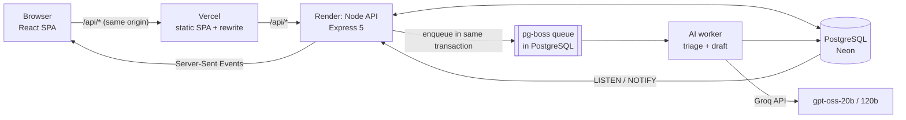

# BookLeaf — Author Support & Communication Portal

A web app with two portals for BookLeaf Publishing:
- **Author portal:** authors see their books and royalties, raise support queries and follow the replies live.
- **Admin portal:** the operations team works one queue, with AI classification, AI priority and an AI-drafted reply for every ticket.

| | |
|---|---|
| **Live app** | https://YOUR-APP.vercel.app |
| **API docs (Swagger UI)** | https://YOUR-RENDER-SERVICE.onrender.com/api/docs |
| **OpenAPI spec** | https://YOUR-RENDER-SERVICE.onrender.com/api/v1/openapi.json |

> The API runs on Render's free tier, which sleeps when idle. The **first request can take about a minute** while it wakes up; after that it is fast.

## Test logins

Seeded from `bookleaf_sample_data.json` (10 authors, 18 books) plus two admins.

| Role | Email | Password | Good for testing |
|---|---|---|---|
| Admin | `aditi.rao@bookleaf.test` | `Admin@12345` | Queue, AI draft, overrides, notes |
| Admin | `karan.mehta@bookleaf.test` | `Admin@12345` | A second agent (assignment, conflicts) |
| Author | `priya.sharma@email.com` | `Author@12345` | Normal case; one book with ₹0 pending |
| Author | `sneha.kulkarni@email.com` | `Author@12345` | 3 books; *Midnight in Mysore* is in production (Cover Design) |
| Author | `kavita.deshmukh@email.com` | `Author@12345` | Book in production (Typesetting); ₹850 pending, below the ₹1,000 threshold; never paid |
| Author | any other author email in the dataset | `Author@12345` | |

To see real-time updates, open the author and the admin in two different browsers (or one normal and one private window), because one browser holds only one login cookie.

## What it does

**Author portal**
- **My Books:**
  - Every field from the brief: title, ISBN, genre, publication date, status, MRP, copies sold, and royalty earned / paid / pending.
  - Royalty totals, the next payout date, and a clear message when the pending amount is below the ₹1,000 payout threshold.
  - Books still in production show a "Book in production · *stage*" badge and "Not published yet" instead of empty values.
- **New ticket:**
  - Book dropdown, including "General / Account Level", plus subject and description.
  - An attachment picker that is UI only, as the brief allows. It checks file type and size, and says that files are not uploaded.
- **My Tickets:** status, the original query and BookLeaf's replies. New replies appear **without a page refresh**. The author can reply, and replying to a resolved ticket reopens it.

**Admin portal**
- **Ticket queue:**
  - Filters for status (default: unresolved), category, priority and created date, plus four sort orders.
  - The default order is: unresolved first, then overdue, then by priority, then oldest first.
  - Overdue rows are red, and badges show "Overdue", "Due soon" and "Needs review".
- **Ticket page:**
  - Status, priority and category dropdowns. Each shows who set it (AI / rules / admin), and after an override also what the AI suggested and how sure it was.
  - "Assign to me" and internal notes, which authors never see.
- **AI draft:** it is already in the reply box when the admin opens the ticket.
  - The admin edits it and sends, or regenerates it.
  - Notes for the admin ("verify X before sending") are shown above the box and are never sent.
  - If the AI is down, the admin simply writes the reply.

## Architecture



- **Hosting.** Render runs the API and the AI worker in one service. Vercel serves the frontend and forwards `/api` to Render. The database is PostgreSQL on Neon.
- **Modular monolith.** One Node.js codebase, split into modules that each own their tables and rules: `auth`, `book`, `ticket`, `ai`, `realtime`, `admin`, plus a shared `core`. Each module has the same layers:
  - `routes` → `controller` → `service` → `query`, where only the query layer talks to the database;
  - `schema` (Zod validation), `mapper` (API shape), `errors` and `openapi`.
- **AI runs in the background.** Creating a ticket never waits for the AI. The ticket and its AI job are written in one database transaction, so a job is never lost and never runs for a ticket that was rolled back. The worker can run as its own process (`npm run start:worker`) or inside the API process (`RUN_WORKER_IN_PROCESS=true`, used on Render's free plan).
- **Real-time.** Every change publishes a small event (`{ type, ticketId }`, never content) through PostgreSQL `LISTEN/NOTIFY`. The API pushes it to connected browsers over SSE, and the browser re-fetches what is on screen through the normal, permission-checked endpoints.
  - Authors only receive events for their own tickets, and never for internal notes.
  - On reconnect the browser refreshes once, so missed events don't matter.

### Key decisions

| Decision | Why |
|---|---|
| Node.js 24 (JavaScript, ESM) + Express 5 + Zod 4 | Small, well-known stack. One Zod schema both validates a request and generates its API documentation |
| PostgreSQL + Prisma 7 | Relational data (authors → books → tickets → messages). CHECK constraints in the database keep data valid even if code has a bug |
| Money as integer paise | No floating-point rounding errors; ₹ formatting happens only at the edges |
| **pg-boss** queue in PostgreSQL | Retries with backoff and one job per ticket. No Redis to run, and jobs are enqueued in the same transaction as the ticket |
| Cookie auth: 15-min access JWT + rotating 7-day refresh token | `httpOnly` cookies can't be read by scripts. Refresh tokens are stored hashed, and reusing an old one revokes the whole session family |
| SSE instead of WebSockets | Updates only flow server → browser, and SSE uses plain HTTP and cookies, with automatic reconnect |
| Same-origin `/api` via a Vercel rewrite | The browser sees one origin, so cookies stay first-party (`SameSite=Lax`) and no CORS is needed |
| React + Vite + TanStack Query + Tailwind | Every screen is behind login, so there's no need for SSR. TanStack Query makes "live update" a one-line refetch |
| Ownership checked in every query | An author asking for another author's ticket gets **404**, not 403, so nothing about other tickets leaks |

## AI integration

Two AI tasks, both on [Groq](https://groq.com) with OpenAI's open-weight **gpt-oss** models:

| Task | When | Model | Output |
|---|---|---|---|
| **Triage** | Right after a ticket is created | `openai/gpt-oss-20b`, low reasoning | Category (one of 6), priority (Critical → Low), confidence, one-line reason |
| **Draft reply** | After triage, and after each new author message | `openai/gpt-oss-120b`, medium reasoning; falls back to 20b | Reply text + internal hints for the admin |

**Why Groq + gpt-oss.**
- Both models support **strict JSON-schema output**, so the answer always has the expected shape.
- They are very fast: triage takes about 1–2 s and a draft about 2–4 s.
- They are cheap: the small model handles the frequent call (triage), and the large model handles the reply people read.
- Groq's free tier was enough for development.
- The provider sits behind one small interface (`complete()`), so switching to OpenAI or Anthropic is a single new file.

### Prompt strategy
- **Code computes the facts; the model only writes.** Royalty totals, the payout threshold, the next payout deadline and the date range it covers are calculated in code from the database and passed in a `<facts>` block, already formatted ("₹7,865", "14 Nov 2026"). The model must quote them exactly and never calculate money or dates.
- **Only the knowledge base for the ticket's category** is sent. For example, a royalty ticket gets only the royalty policy and the royalty sample answers, plus the tone guidelines. This is about 150–300 tokens instead of the whole KB.
- **Tone rules from the brief are hard rules:** acknowledge first, be specific, own BookLeaf's mistakes, give a clear timeline (e.g. 48 hours), end with a next step, and never blame the author.
- **Safety rules:**
  - Never invent amounts, dates, ISBNs or contact details.
  - If something is unknown, leave a `[placeholder]`. The API **refuses to send** a reply that still contains one.
  - If a payout looks late, say "our team is checking the payout records", never "overdue".
  - Ask for more details "on this ticket"; email (`SUPPORT_EMAIL`) is only for photos of a damaged copy.
- **Customer text is treated as data.** It is wrapped in tags, tags inside it are stripped, and the prompt says to ignore instructions in it. This defends against prompt injection.
- **Privacy:** only the author's first name goes to the model.
- **Versioned prompts** (`triage.v2`, `draft.v2`). Every AI call is logged with its prompt version, so changes can be compared.

### When the AI fails
- A ticket gets a **keyword-rules classification instantly**, before any AI call, so the queue is never empty or unsorted.
- AI jobs retry up to 3 times with backoff.
- A **circuit breaker** stops calling Groq for 60 s after 5 failures in a row.
- An invalid answer gets **one repair attempt**, where the problem is sent back to the model. A failed draft on 120b falls back to 20b.
- If triage still fails, the rules result stays and the ticket is marked "Needs review". If the draft fails, the admin sees "AI draft failed" and writes the reply; **ticket creation and manual replies never depend on the AI**.
- Low-confidence triage (< 0.6) is marked "Needs review".
- An admin's override is never overwritten by a later AI run.

### Cost awareness
- The conversation window is capped: the original query plus the **last 4 messages**, each shortened. Draft input stays around 1.5–2.5k tokens however long the thread gets.
- Each prompt is built as a stable system part and a small variable part, so Groq's prompt cache can be reused.
- **Every call is logged** in `ai_invocations` with the model, input / cached / output tokens, latency, estimated cost (USD) and outcome. `GET /stats/overview` shows totals, the failure rate, the cache hit rate and the cost.
- Real numbers: a ticket's triage + draft costs about **$0.0005–0.001**. The full 21-case triage evaluation cost **$0.002**.

### Measured quality
- `npm run eval:triage` runs 21 labelled cases through the real model. They include the brief's sample queries, Hinglish, prompt injection, "a few months" versus "7 months" unpaid, and vague "refund" wording.
- Current result for `triage.v2`: **category 100%, priority 100%**. The keyword rules alone score 95% / 86%.

## API

- 23 endpoints under `/api/v1`, all documented in **Swagger UI at `/api/docs`**, which is generated from the same Zod schemas that validate requests.
- Every route except login, refresh and logout needs the session cookie.
- **Errors** always have the same shape: `{ "error": { "code", "message", "details?", "requestId" } }`.
  - `400` validation (with field details)
  - `401` not logged in
  - `403` wrong role or foreign origin
  - `404` not found or not yours
  - `409` version conflict or invalid status change
  - `422` unfilled placeholder
  - `429` rate limit

| Method | Path | Who | What |
|---|---|---|---|
| POST | `/auth/login` | public | Log in (sets cookies; rate-limited 5/min) |
| POST | `/auth/refresh` | refresh cookie | New access token (rotates the refresh token) |
| POST | `/auth/logout` | public | Log out (revokes the session) |
| GET | `/auth/me` | author, admin | Current user |
| GET | `/books` | author, admin | Own books (author) / all books (admin) |
| GET | `/books/summary` | author | Royalty totals, threshold, next payout |
| GET | `/books/{bookId}` | author (own), admin | One book |
| POST | `/tickets` | author | Raise a ticket |
| GET | `/tickets` | author, admin | Own tickets / queue with filters, sort, paging |
| GET | `/tickets/{ticketId}` | author (own), admin | One ticket (admins also see AI fields, SLA, `version`) |
| PATCH | `/tickets/{ticketId}` | admin (author: close only) | Status, category, priority, assignee; needs `version` |
| GET / POST | `/tickets/{ticketId}/messages` | author (own), admin | Conversation / reply |
| GET / POST | `/tickets/{ticketId}/notes` | admin | Internal notes |
| GET | `/tickets/{ticketId}/events` | admin | Activity log |
| GET | `/tickets/{ticketId}/ai-draft` | admin | Current AI draft |
| POST | `/tickets/{ticketId}/ai-draft/regenerate` | admin | New draft (max 5 per 10 min) |
| POST | `/tickets/{ticketId}/ai-draft/send` | admin | Send the (edited) draft |
| POST | `/tickets/{ticketId}/triage/retry` | admin | Run AI triage again |
| GET | `/events/stream` | author, admin | Live updates (SSE) |
| GET | `/admins` | admin | Active admins |
| GET | `/stats/overview` | admin | Queue, SLA and AI statistics |

Also, without a login: `GET /healthz` (liveness) and `GET /readyz` (database + queue).

### Business rules worth knowing
- **SLA for the first reply:** Critical 4 h, High 24 h, Medium 48 h, Low 72 h. "Due soon" means the last 25% of that window.
- **Status flow (admin):** Open ↔ In Progress → Resolved → Closed, and Resolved can go back to Open. The first admin reply moves Open to In Progress, and "Assign to me" does the same. Closed is final.
- **Optimistic locking:** an admin's change must send the ticket's `version`. If another admin changed it first, the API answers `409` and the UI reloads.
- **Data edge cases from the dataset:**
  - Books in production have no MRP, publication date or royalties.
  - Two books in production already have an ISBN before the "ISBN Assignment" stage. It is shown as-is with a "Book in production" badge, the AI hint warns the admin to verify it, and this is noted as a question for BookLeaf.

## Security
- Secrets (`GROQ_API_KEY`, `JWT_ACCESS_SECRET`, `DATABASE_URL`) live only in the backend environment. **The frontend has no environment variables and no keys.**
- Passwords are hashed with argon2id. Login answers in the same time for unknown emails, so emails can't be discovered, and it is rate-limited per IP + email.
- `httpOnly`, `Secure`, `SameSite=Lax` cookies. Writes from an origin not in `ALLOWED_ORIGINS` are rejected (CSRF protection). API bodies must be JSON and at most 100 kB.
- Helmet security headers. Logs redact cookies, passwords and tokens. User and AI text is rendered as plain text, never HTML.

## Run it locally

**Needs:** Node.js 24, a PostgreSQL database (local or a free [Neon](https://neon.tech) project) and a Groq API key (free at console.groq.com). Without a key, set `AI_PROVIDER=fake` to use a built-in fake AI.

```bash
# 1. Backend
cd backend
npm install
cp .env.example .env          # then fill DATABASE_URL, JWT_ACCESS_SECRET (32+ chars), GROQ_API_KEY
npx prisma generate
npm run db:migrate            # creates the tables
npm run db:seed               # loads bookleaf_sample_data.json + 2 admins (safe to run again)
npm run dev                   # API on http://localhost:4000  (Swagger: /api/docs)
npm run dev:worker            # in a second terminal: AI triage and drafts

# 2. Frontend
cd frontend
npm install
npm run dev                   # http://localhost:5173 (proxies /api to :4000)
```

**Tests:**

```bash
cd backend
npm run test:unit             # 220 fast tests, no database
npm run test:integration      # ~100 tests against DATABASE_URL (real PostgreSQL, fake AI)
npm run eval:triage           # 21 cases against the real Groq model (needs GROQ_API_KEY)
cd ../frontend && npm test    # API client and formatting
```

Integration tests create and delete their own users (`@auth-test.bookleaf.test`) but use the database in `DATABASE_URL`. Point it at a separate database, and **stop the worker while they run**, otherwise the worker picks up the tests' jobs.

## Project structure

```
backend/
  src/core/            logger, errors, middlewares, database, queue, events, OpenAPI registry
  src/modules/<name>_module/
                       <m>.routes / controller / service / query / schema / mapper / errors / openapi / prisma
  src/modules/ai_module/
                       prompts/ (versioned), knowledge_base/, facts/, providers/ (groq, fake, resilient), triage/, drafts/
  prisma/              migrations (with hand-written CHECK constraints) and the seed
  tests/               unit, integration, ai-eval
frontend/
  src/api.js           every API call, error type, refresh-on-401
  src/realtime.jsx     SSE → refresh the data on screen
  src/pages/           the author and admin screens
bookleaf_sample_data.json
```

## Known limitations and what I'd do next
- **Attachments are UI only**, as the brief allows. Next: object storage with pre-signed uploads, virus scanning and an `attachments` table.
- **Free hosting:**
  - Render sleeps when idle (slow first request).
  - Groq's free tier allows about 8,000 tokens per minute, so a burst of tickets waits on retries; the keyword classification covers the queue meanwhile.
  - A paid plan, and a separate worker service, fix both.
- **SSE through the Vercel rewrite:** if a proxy buffers the stream, updates still arrive on the next page focus or navigation (TanStack Query refetches), but not instantly. Next: a polling fallback, or a direct Render URL for the stream.
- **No email notifications** to authors. Replies are only visible in the portal. Next: an email on every BookLeaf reply.
- **No sign-up or password reset.** Accounts come from the seed.
- **Statistics have an API (`/stats/overview`) but no dashboard screen yet.**
- **Ambiguous money wording** ("refund") is now ranked at least Medium, but whether it is flagged "Needs review" depends on the model's confidence on that run.
- **Questions for BookLeaf:**
  - Can a book have an ISBN before the "ISBN Assignment" stage?
  - Is the ₹1,000 threshold per author or per book? We assumed per author.
  - Are US / UK royalties paid in INR?
  - What is the real support email?
